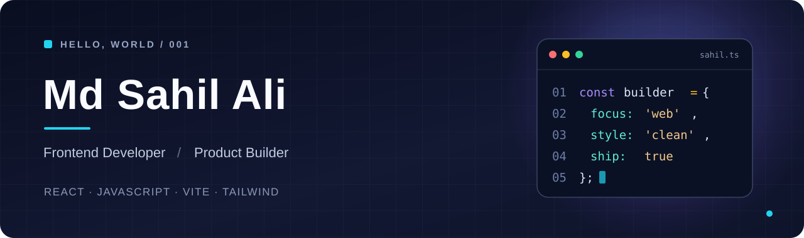

<div align="center">
  
</div>

<br />

<div align="center">
  <a href="https://www.paperlane.world/"></a>
  <a href="https://www.linkedin.com/in/mdsahilali/"></a>
  <a href="mailto:aksahil18@gmail.com"></a>
</div>

<br />

## `> whoami`

I'm **Md Sahil Ali**, a Computer Science graduate and frontend developer focused on building useful, responsive, and thoughtfully designed experiences for the web.

I enjoy taking something that feels complicated and turning it into a product that feels simple. My work spans **React interfaces, browser-based tools, performance-focused websites, and practical product ideas**.

- **Currently building:** [Paperlane](https://www.paperlane.world/) — everyday document and image tools for the browser.
- **I care about:** intuitive UI, accessibility, speed, and the details that make software enjoyable.
- **Let's collaborate on:** frontend projects, developer tools, and useful web products.

## `> selected_projects`

<table>
  <tr>
    <td width="50%" valign="top">
      <h3>📄 Paperlane</h3>
      <p>My browser-first toolkit for working with PDFs and everyday files — built around simple workflows, privacy-conscious design, and a fast user experience.</p>
      <p><a href="https://www.paperlane.world/"><strong>Visit Paperlane ↗</strong></a></p>
    </td>
    <td width="50%" valign="top">
      <h3>🛒 Cartify</h3>
      <p>An ecommerce-themed web project focused on presenting a polished, accessible shopping interface.</p>
      <p><a href="https://cartify-site.vercel.app/"><strong>View live project ↗</strong></a></p>
    </td>
  </tr>
  <tr>
    <td width="50%" valign="top">
      <h3>🌐 Webcreation</h3>
      <p>A deployed web project that reflects my interest in clean layouts and engaging frontend experiences.</p>
      <p><a href="https://webcreation-site.vercel.app/"><strong>View live project ↗</strong></a></p>
    </td>
    <td width="50%" valign="top">
      <h3>⚡ What I'm exploring</h3>
      <p>More performant React apps, better browser-side tooling, search-friendly websites, and ways to make web products easier to use.</p>
      <p><a href="https://github.com/MdSahilAlii?tab=repositories"><strong>Explore my repositories ↗</strong></a></p>
    </td>
  </tr>
</table>

## `> tech_stack`

**Frontend**


**Tools & deployment**


## `> the_way_i_build`

```javascript
const approach = {
  design: "Clear, responsive, and accessible",
  engineering: "Practical solutions over unnecessary complexity",
  performance: "Fast by default",
  mindset: "Build → test → improve → ship"
};
```

---

<div align="center">
  <p><strong>Have a project in mind or want to connect?</strong></p>
  <a href="https://www.linkedin.com/in/mdsahilali/">LinkedIn</a> &nbsp;·&nbsp;
  <a href="mailto:aksahil18@gmail.com">Email</a> &nbsp;·&nbsp;
  <a href="https://www.paperlane.world/">Paperlane</a>
  <br /><br />
  <sub>Made with curiosity, clean code, and a lot of iteration.</sub>
</div>
